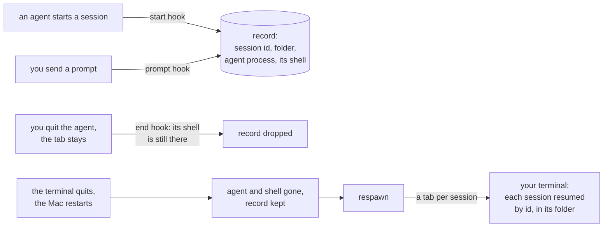

# respawn

**Your terminal quit. Your Mac restarted. Every coding agent comes back, right where it was.**

[](https://github.com/lorenzobalzani/respawn/actions/workflows/ci.yml)
[](LICENSE)


<p align="center"></p>

You had eight agent sessions open: Claude Code in one tab, Codex in another, Gemini CLI on the infra repo.
Then the terminal updated itself, or the Mac restarted, or you hit <kbd>⌘</kbd><kbd>Q</kbd>. The tabs may come
back, but the agents in them don't. Each agent kept its conversations on disk, and each can resume one by id,
but none of them remembers **which ones were open**. So you scroll a list of a few hundred past sessions,
trying to remember what you were doing.

respawn remembers. After the crash, one command:

```console
$ respawn
```

lists every agent session that was cut off, with the folder it ran in and the first thing you asked it, and
reopens each one in its own tab of the terminal you're in, resumed by id, in its own folder.

## Install

```bash
curl -fsSL https://raw.githubusercontent.com/lorenzobalzani/respawn/main/install.sh | bash
```

Or from a clone: `git clone https://github.com/lorenzobalzani/respawn.git && cd respawn && ./install.sh`.

The installer puts `respawn` in `~/.local/bin` and adds its hooks to every supported agent it finds. It
changes nothing else in their settings, keeps a backup of every file it edits, writes a settings file that is a
symlink (stow, chezmoi) where the link points, leaves alone a file that isn't valid JSON, and adds nothing when
run again. Sessions you start from then on are recorded; ones already open are recorded on their next prompt, so
there is nothing to restart. Install an agent later? Run `respawn setup`.

**Upgrading from claude-restore 0.1.0?** The installer takes its hooks out of Claude Code's settings, and tells you
where its script and its records are, so that you can delete them.

**Needs:** bash (the 3.2 that macOS ships is enough) and `jq` (in macOS 15 and later; otherwise
`brew install jq` or `apt install jq`). Nothing else, and nothing ever leaves your machine.

## Usage

| Command | What it does |
| :- | :- |
| `respawn` | List the cut-off sessions, ask, reopen them in new tabs |
| `respawn -y` | Reopen all of them without asking |
| `respawn --list` | Only list them |
| `respawn --dry-run` | Print the commands instead of opening anything |
| `respawn --in kitty` | Open them in another terminal than the one you're in (with any of the above: `respawn -y --in kitty`) |
| `respawn --clear` | Forget the cut-off sessions (each agent still has them in its own resume list) |
| `respawn setup` | Add the hooks to every supported agent installed here |
| `respawn doctor` | Show the agents respawn sees, their hooks, your terminal, its records |
| `respawn uninstall` | Remove the hooks and the records |

When it asks, type `1 3` to reopen only some of them. If the terminal fails to open them (no display, not
installed), respawn says so, prints the commands instead, and keeps every session for next time.

## Agents

| Agent | Resumed with | Checked |
| :- | :- | :- |
| [Claude Code](https://code.claude.com) | `claude --resume <id>` | **Live**: a real session, quit and closed |
| [Codex](https://github.com/openai/codex) | `codex resume <id>` | Its source; tested with a stand-in |
| [Gemini CLI](https://github.com/google-gemini/gemini-cli) | `gemini --resume <id>` | Its source; tested with a stand-in |
| [GitHub Copilot CLI](https://docs.github.com/en/copilot/how-tos/use-copilot-agents/use-copilot-cli) | `copilot --resume=<id>` | Its docs; tested with a stand-in |
| [Cursor CLI](https://cursor.com/cli) | `cursor-agent --resume=<id>` | Its docs; tested with a stand-in |
| [Qwen Code](https://github.com/QwenLM/qwen-code) (0.14 and later) | `qwen --resume <id>` | Its source; tested with a stand-in |
| [Factory Droid](https://factory.ai) | `droid --resume <id>` | Its docs; tested with a stand-in |
| [Kiro CLI](https://kiro.dev/cli) | `kiro-cli chat --resume-id <id>` | Its docs; tested with a stand-in |
| [OpenCode](https://opencode.ai) 1.x | `opencode -s <id>` | Its source; tested with a stand-in |

**Codex** runs a hook only once you approve it: after installing, open Codex, type `/hooks` and approve
respawn's three. **OpenCode** has no command hooks, so respawn installs a small plugin instead, which hands each
event to respawn without making OpenCode wait.

"Tested with a stand-in" means the test suite runs that agent's hook flow under a fake process that carries the
agent's name, command line, terminal and shell, the way the real one does. If an agent behaves differently on
your machine, `respawn doctor` and an issue with its output are the fastest way to a fix.

**Not yet:** [Goose](https://github.com/aaif-goose/goose) (its plugin manifest isn't documented),
[Crush](https://github.com/charmbracelet/crush) (where its user-level hooks file lives), [Amp](https://ampcode.com)
(plugins only, with no session end and no folder), OpenCode 2 (plugins run in a shared server, away from your
tab) and [Aider](https://aider.chat) (no session ids). Pull requests welcome: an agent is about a dozen lines in
the `agents` section of `respawn`.

## Terminals

respawn opens the sessions in the terminal you run it from, or the one you name with `--in`.

| Terminal | How the sessions open | Checked |
| :- | :- | :- |
| [Warp](https://www.warp.dev) | A window with a tab each, from a launch configuration | **Live** |
| [tmux](https://github.com/tmux/tmux) | A window each in your session, or a new `respawn` session (`respawn-2` if that one is still there) | **Live**, in CI on macOS and Linux |
| [iTerm2](https://iterm2.com) | A window with a tab each (AppleScript) | Stub |
| Terminal.app | A window each: it can't script tabs | Stub |
| [Ghostty](https://ghostty.org) | A window with a tab each: AppleScript on macOS (1.3+), `+new-tab` on Linux | Stub |
| [kitty](https://sw.kovidgoyal.net/kitty/) | A window with a tab each, from a session file (no remote control needed) | Stub |
| [WezTerm](https://wezterm.org) | A window with a tab each (`wezterm cli`) | Stub |
| [Alacritty](https://alacritty.org) | A window each: it has no tabs | Stub |
| [Zellij](https://zellij.dev) | A tab each in your session, from a layout | Stub |
| GNOME Terminal | A window with a tab each | Stub |
| [Ptyxis](https://gitlab.gnome.org/chergert/ptyxis) | A window with a tab each | Stub |
| [Konsole](https://konsole.kde.org) | A window with a tab each, from a tabs file | Stub |

Anything else: on a Mac, Terminal.app windows; on Linux, `x-terminal-emulator` windows; in an editor's
terminal (VS Code, Cursor), the commands printed for you to paste. "Stub" means the tests check exactly what
respawn sends that terminal, through a stand-in for its command, since a real window can't open in CI.

On macOS, the first time respawn drives iTerm2, Terminal.app or Ghostty, macOS asks whether your terminal may
control it. Say yes once.

## How it works

Each agent's own hooks keep a small record of every interactive session: its id, its folder, the agent's
process, and the tab's shell, the one the terminal started. A session is **cut off** when both the agent and that
shell are gone: the terminal went away with them.



The hard part is telling a quit from a closed terminal. Most agents can't: Codex ends every session with the
same reason, and Gemini CLI, Qwen Code and Crush send the same one whether you typed `/quit` or the window
closed. So respawn asks the process tree instead. When a session ends, an agent you quit is still the child of
its shell; an agent whose terminal closed has already lost it. That was measured, not assumed: with a real
Claude Code in a real shell, a closed terminal left the agent reparented before its end hook ran, in every run,
and `/exit` never did.

An agent may take a while to exit after its session ends (MCP servers stopping), and a closing terminal's shell
may outlive its agent for a moment (zsh saves its history first), so respawn waits for both: up to 30 seconds for
the agent, then 2 seconds for the shell. It waits in the background, and the agent never waits for it.

| The session ended because | respawn |
| :- | :- |
| The terminal quit, the Mac restarted, the window or tab closed, the terminal crashed | Offers it |
| You quit the agent and kept using the tab | Forgets it |
| You switched with `/clear`, `/resume` or Codex's `/new` | Forgets it, and records the session you switched to |
| The agent unloaded it while idle (Codex does, after 30 minutes) | Keeps it: it's still open |
| A run with no terminal (cron, CI, an editor's background process) or a background session | Never records it |
| A subagent or a teammate | Never records it |
| Its last activity was more than 7 days ago | Drops it |

A headless run in a terminal (`claude -p`, `codex exec`) is recorded like any session, and forgotten when it
finishes in a tab that stays open.

A few more details:

- **"Gone" means gone.** A record keeps each process's start time as well as its id: after a reboot, ids are
  reused, and a dead shell's zombie still answers `kill -0`. On Linux the start time is counted from boot, as the
  kernel keeps it, so a clock that NTP steps doesn't make a running session look dead.
- **The tab's shell, not whatever started the agent.** A launcher between the shell and the agent (npm's `node`
  for Codex or OpenCode, `npx`, `caffeinate`, `mise exec`) exits with the agent, so respawn records the session
  leader above the agent, which is the shell the terminal started.
- **Codex runs its hooks in a background daemon**, away from your window. respawn finds the window by its folder
  and its terminal instead. A window runs one session at a time, so a new one there (`/new`, `/resume`) replaces
  the old record.
- **A hook belongs to its nearest agent.** Copilot CLI and Cursor CLI also run Claude Code's hooks; respawn
  doesn't mistake their sessions for Claude's, not even when a Claude Code window is open in the same folder.
- **Last activity.** For an agent that keeps a transcript respawn can see, its last write; for the others (Copilot
  CLI, Kiro CLI, OpenCode), the last prompt you sent.
- **Folders that moved.** If a session's folder is gone (a removed worktree, say), its tab opens in your home
  folder, and the agent finds the session by id.
- **Cheap.** The start hook reads the process table once. The prompt hook, for a session already recorded,
  only touches its record.

**A limit, with Codex:** its hooks don't say which client a session belongs to. A session from Codex's own
app-server (one an IDE or the Codex app runs for itself) is left out. But a client that shares the background
daemon of Codex's terminal windows can't be told from them: its session, started in the folder of a Codex window
whose own session isn't recorded as open, is recorded against that window.

### What it touches

Everything stays on your machine; respawn makes no network calls.

| Path | Why |
| :- | :- |
| `~/.local/state/respawn/sessions/` | One small JSON record per open session, written by the hooks |
| Each agent's own hooks file | The hooks, written by `respawn setup`, removed by `respawn uninstall` |
| `~/.claude/history.jsonl` | Read, for a Claude Code session's first prompt when the hooks didn't see it |
| `~/.local/state/respawn/` | The files kitty, Konsole and Zellij open the tabs from |
| `~/.warp/launch_configurations/respawn.yaml` (macOS), `~/.local/share/warp-terminal/launch_configurations/respawn.yaml` (Linux) | The window Warp opens |

## FAQ

**I closed one tab on purpose, and now it's offered.**
Closing a tab ends a session the same way a crash does, so nothing can tell the two apart. The same goes for
quitting an agent and closing its tab within two seconds. Reopen only the ones you want (`1 3`), or run
`respawn --clear`.

**Why not tmux and tmux-resurrect?** That works, if you live in tmux. respawn works in whatever terminal you
already use, tmux included.

**What about Claude Code's background sessions (`claude agents`)?** They survive a closed terminal on their
own, and are listed in `claude agents` after a restart. respawn covers the sessions in your tabs.

**Linux?** Yes: the hooks, the records, tmux, and the Linux terminals above. CI runs the whole suite on Ubuntu.

## Uninstall

```bash
respawn uninstall && rm ~/.local/bin/respawn
```

Or `./install.sh --uninstall` from a clone. Either removes respawn's hooks from every agent, including one that is
no longer on your PATH, and nothing else.

## Development

```bash
tests/test.sh                                      # 150+ tests, each against a throwaway HOME
shellcheck -x respawn install.sh tests/test.sh
```

The tests give every agent a realistic life: a pseudo-terminal, a shell in it, a stand-in for the agent under the
shell (`tests/fake_agent.c`), and the agent's hooks run by it, including a terminal that closes mid-session
(`tests/in_terminal.py`), which hangs up the stand-in the way it hangs up a real agent. Each terminal is driven
through a stub that records what respawn sent it, and tmux for real. CI runs it all on macOS and Ubuntu.

## License

[MIT](LICENSE). Not affiliated with the makers of any agent or terminal it supports.
