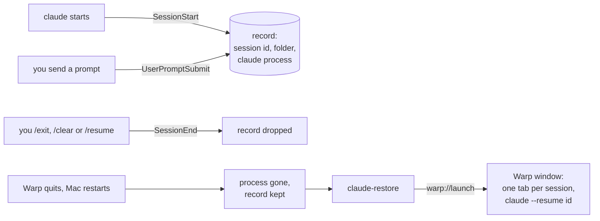

# claude-restore

**Quit Warp. Restart your Mac. Get every Claude Code session back.**

[](https://github.com/lorenzobalzani/claude-restore/actions/workflows/ci.yml)
[](LICENSE)


You have eight Claude Code sessions open in Warp tabs. Warp installs an update, the Mac restarts, or you hit
<kbd>⌘</kbd><kbd>Q</kbd>. Warp brings the tabs back, but not what ran in them: every Claude session is gone.
`claude --resume` lists a few hundred past conversations, with no hint of which eight were open or what
each one was doing.

The conversations themselves are safe, since Claude Code saves every transcript to disk. What you lose is
**which ones were open**. claude-restore keeps track of that, and brings them all back with one command:

```console
$ claude-restore
3 Claude session(s) were cut off:
   1. ~/code/api                      12m ago  migrate the billing tables to the new schema
   2. ~/code/web                      14m ago  fix the flaky checkout end-to-end test
   3. ~/code/infra                     1h ago  why does the deploy hang on the migration step?
Reopen them in a new Warp window? [Y/n, or numbers like "1 3"]
```

Press <kbd>Enter</kbd> and one Warp window opens, with a tab per session. Each tab starts in that session's
own folder and runs `claude --resume <id>`, so you are back in the same conversation.

## Install

```bash
curl -fsSL https://raw.githubusercontent.com/lorenzobalzani/claude-restore/main/install.sh | bash
```

Or from a clone:

```bash
git clone https://github.com/lorenzobalzani/claude-restore.git
cd claude-restore && ./install.sh
```

The installer does two things:

- copies `claude-restore` to `~/.local/bin` (`BIN_DIR=... ./install.sh` to put it elsewhere)
- adds three hooks to `~/.claude/settings.json`, leaving everything else in it as it was. It backs the file
  up first, refuses to touch a file that is not valid JSON, and adds nothing when run again.

Sessions you start after installing are recorded right away. Sessions that are already open get recorded
on their next prompt, so there is nothing to restart.

**Needs:** macOS, [Warp](https://www.warp.dev), [Claude Code](https://code.claude.com), and `jq` (it ships
with macOS 15 and later; otherwise `brew install jq`).

## Usage

| Command | What it does |
| :- | :- |
| `claude-restore` | List the cut-off sessions, ask, reopen them in a new Warp window |
| `claude-restore -y` | Reopen all of them without asking |
| `claude-restore --list` | Only list them |
| `claude-restore --dry-run` | Print the Warp launch configuration instead of opening it |
| `claude-restore --clear` | Forget the cut-off sessions without reopening them (they stay in `claude --resume`) |

When it asks, type `1 3` to reopen only some of them.

## How it works

Three [Claude Code hooks](https://code.claude.com/docs/en/hooks) keep a small record of every interactive
session: its id, its folder, and the `claude` process running it. A record whose process is gone is a
session that was **cut off**: its terminal went away before you left it.



How a session ended decides whether it comes back:

| The session ended because | claude-restore |
| :- | :- |
| Warp quit, the Mac restarted, the window closed, the terminal crashed | Offers it |
| You left it with `/exit` (or quit at the prompt) | Forgets it |
| You switched away with `/clear` or `/resume` | Forgets it, and records the session you switched to |
| It was a `claude -p` run, an SDK run or a background session | Never records it (none of those has a terminal) |
| It was a subagent or a teammate | Never records it |
| It was cut off more than 7 days ago | Drops it |

A few details make this reliable:

- **"Gone" means gone.** A record stores the process id *and* its start time. After a reboot, process ids get
  reused, so a pid alone could make a dead session look alive.
- **Nothing to resume, nothing offered.** A session that was opened and closed without a single message
  has no transcript, and is dropped.
- **Folders that moved.** If a session's folder no longer exists (a removed git worktree, say), its tab
  opens in your home folder and `claude --resume` finds the session by id anyway.
- **Each entry shows the first real prompt** (the first one that is not a slash command), so you see what
  the session was about rather than its last "go on".
- **Cheap.** The per-prompt hook takes about 20 ms, and returns at once for a session it has already
  recorded.

### What it touches

Everything stays on your machine. Nothing goes over the network.

| Path | Why |
| :- | :- |
| `~/.claude/session-restore/open/<session-id>.json` | One record per open session (written by the hooks) |
| `~/.claude/history.jsonl` | Read, to show each session's first prompt |
| `~/.claude/settings.json` | The three hooks (written by the installer only) |
| `~/.warp/launch_configurations/claude-restore.yaml` | The window `claude-restore` opens |

## FAQ

**Why not tmux and tmux-resurrect?**
That works, but Warp's own features (blocks, its input editor) don't work inside tmux. claude-restore keeps
you in plain Warp tabs.

**Does it work with iTerm2, Ghostty or Terminal.app?**
Recording works in any terminal. Reopening the tabs is Warp-only today, through Warp's
[launch configurations](https://docs.warp.dev/terminal/sessions/launch-configurations). In another terminal,
`claude-restore --dry-run` prints the session ids to resume. Pull requests for other terminals are welcome.

**What about Claude Code's background sessions (`claude agents`)?**
They keep running when Warp quits, and after a restart they are listed in `claude agents`, so they don't
need this. claude-restore covers the sessions you run in your tabs.

**I closed one tab on purpose, and now it is offered.**
Closing a tab ends a session the same way a crash does, so the hooks can't tell the two apart. Reopen only
the ones you want (`1 3`), or run `claude-restore --clear`.

**Linux?**
The hooks are portable. Reopening is macOS-only for now (`open`, and Warp's macOS paths); `--list` and
`--dry-run` work anywhere.

## Uninstall

```bash
./install.sh --uninstall
```

This removes the script, its three hooks (and nothing else from your settings) and its records.

## Development

```bash
tests/test.sh                                          # 35 tests, each against a throwaway HOME
shellcheck -x claude-restore install.sh tests/test.sh
```

The tests run each hook the way Claude Code does: as a child of a stand-in `claude` process that has its own
pseudo-terminal (`tests/fake_claude.c`, `tests/in_terminal.py`).

## License

[MIT](LICENSE). Not affiliated with Anthropic or Warp.
